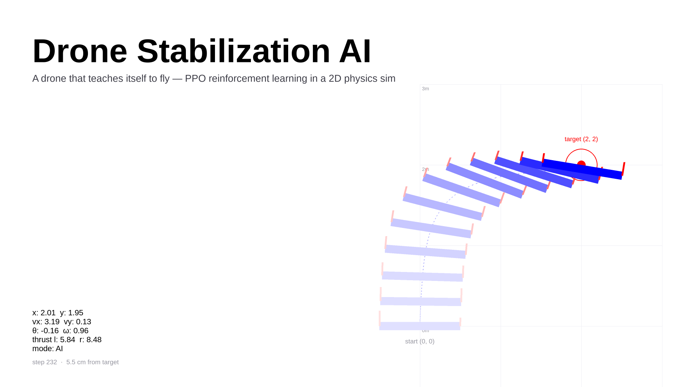

# 🚁 Drone Stabilization AI  



This project is a **physics-based simulation** where a drone learns to **stabilize itself** using **reinforcement learning**. It employs an **Actor-Critic neural network** to make real-time stabilization decisions, adapting to dynamic conditions through trial and error.

## 🚀 Features  
- Reinforcement Learning: Uses an Proximal Poclicy Optimization (PPO Actor-Critic) to train.  
- Physics Simulation: (Somewhat) realistic drone motion with forces and torque calculations.  
    - Playable by both the AI and the User
- Visualization: Built with **Pygame** for to display saved models' performances
    - No visualization during training, but there are generated checkpoints that can be visualized as the model trains

## 🏃‍♂️ Running The Simulation

```sh
python train.py
```

The simulation creates logs that are visualized via tensorboard (localhost website). When running `train.py` it will by default make a directory `runs/` that will store logs.

To run tensorboard:

```sh
tensorboard --logdir=runs
```

### Environment

This project was built and tested around `Python 3.11` (so it might not work on other versions).

Dependencies:

```sh
pip install torch numpy pygame tensorboard
```
